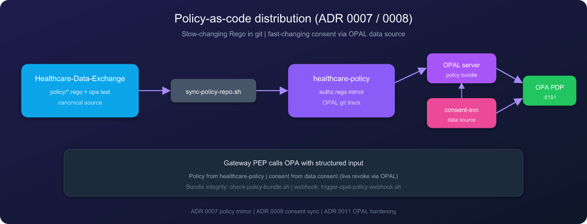

<p align="center">
  
</p>

<h1 align="center">healthcare-policy</h1>

<p align="center">
  <strong>OPAL-tracked policy mirror</strong> for
  <a href="https://github.com/SafetyMP/Healthcare-Data-Exchange">synthetic FHIR cell demo</a>
</p>

<p align="center">
  <a href="https://github.com/SafetyMP/healthcare-policy/actions/workflows/portfolio-verify.yml"></a>
  <a href="https://github.com/SafetyMP/Healthcare-Data-Exchange"></a>
</p>

---

> **Do not edit Rego here.** Canonical source and OPA tests live in `policy/` on [Healthcare-Data-Exchange](https://github.com/SafetyMP/Healthcare-Data-Exchange). That repository's `scripts/sync-policy-repo.sh` pushes updates here. This mirror does not contain that script. Clone Healthcare-Data-Exchange to change policy.

## Follow a research access request

A research team asks to read a synthetic patient record. What should happen to the next request if the patient withdraws research consent? Change the consent state and inspect the decision in the [interactive Healthcare Data Exchange case](https://safetymp.github.io/Healthcare-Data-Exchange/#research-request).

The browser uses fixtures. In the reference backend, the [mirrored rule](authz.rego) reads research consent from `data.consent`. OPAL distributes changes to that data separately from the rules it tracks in Git. The [canonical pointer](.harness/canonical-pointer) identifies the policy source revision and bundle hash at the last sync. The [consent design](https://github.com/SafetyMP/Healthcare-Data-Exchange/blob/main/docs/adr/0008-opal-consent-sync.md) describes the backend path from withdrawal to a new decision.

**For the exchange team that owns gateway releases.** Would distributing rules separately save enough coordinated release work to justify running OPAL? Compare staff time for the same rule change under both approaches, including the time to confirm that each endpoint uses the new revision. [OPA management architecture](https://www.openpolicyagent.org/docs/management-introduction) · [Project distribution design](https://github.com/SafetyMP/Healthcare-Data-Exchange/blob/main/docs/adr/0007-opal-policy-mirror.md)

**For the exchange privacy lead.** Agree with a patient representative on what a person withdrawing consent should be told about when the change takes effect. Set a timing criterion with the release team, withdraw synthetic research consent, and measure how long each endpoint takes to consistently deny the request. CRISP, a regional exchange, assigns daily privacy matters to its privacy and security officer and consults its consumer council on opt-out and data use. [CRISP governance](https://www.crisphealth.org/governance/) · [ONC guidance on meaningful consent](https://healthit.gov/privacy-security/patient-consent-electronic-health-information-exchange/)

## Architecture

| Policy + OPAL flow | Social preview |
|:------------------:|:--------------:|
|  | Regenerate with `./scripts/render-assets.sh` then upload `docs/assets/social-preview.png` |

See [ADR 0007](https://github.com/SafetyMP/Healthcare-Data-Exchange/blob/main/docs/adr/0007-opal-policy-mirror.md) on the canonical repo.

## Harness

Profile: **policy-mirror** · Portfolio: [`specs/portfolio.yaml`](specs/portfolio.yaml) · Verify: `./scripts/verify.sh`

## OPAL bundle

| Path | Role |
|------|------|
| `authz.rego` | `chex.authz` package; consent from `data.consent` |
| `.manifest` | OPA bundle roots (`chex`) for OPAL |
| `.harness/canonical-pointer` | Last canonical commit + bundle hash |

## Canonical workflow

```bash
# On Healthcare-Data-Exchange (canonical)
./scripts/verify.sh
./scripts/sync-policy-repo.sh   # pushes policy mirror here
```

## Assets

Diagram sources and PNG exports: [`docs/assets/`](docs/assets/README.md)

## License and security

Apache License 2.0. See [`LICENSE`](LICENSE), [`SECURITY.md`](SECURITY.md), [`CONTRIBUTING.md`](CONTRIBUTING.md), and [`CODE_OF_CONDUCT.md`](CODE_OF_CONDUCT.md).


## Documentation map

[docs/README.md](docs/README.md) lists the repository layout. Community policy files are the root `CONTRIBUTING.md`, `CODE_OF_CONDUCT.md`, and `SECURITY.md`.
